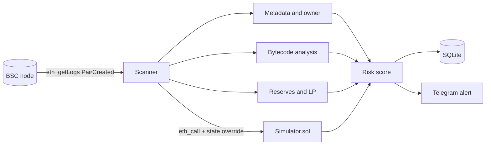

> Assessment v2: the numeric index is heuristic and uncalibrated. It does not represent
> a probability of safety. Security coverage remains partial, even when
> buy/transfer/sell succeed. Older reports must be re-analyzed.
> `min_score` alerts filter on an index, not a buy recommendation.
> Simulation errors and unknown permissions do not prove their absence.

# RugRadar

**Real-time risk scanner for new tokens listed on PancakeSwap (BNB Smart Chain).**
Each new pair is analyzed within seconds: honeypot, hidden taxes, liquidity, dangerous contract functions. The result is a score out of 100, stored in a database and sent to Telegram.


> Analysis tool only: RugRadar holds no private key and never sends a transaction.

## What is checked

| Check | How |
| --- | --- |
| **Honeypot** | Buy → transfer → sell simulated in a single `eth_call` (see below) |
| **Taxes** | Gap between the price quoted by the router and what is actually received, on buy, on sell and between wallets |
| **Liquidity** | The pair's BNB reserve and the share of burned LP tokens (without concluding anything about external locking) |
| **Owner** | `owner()` renounced, active or absent |
| **Dangerous functions** | Bytecode analysis: `mint`, blacklist, tax changes, trading pause, transaction limits |
| **Mutable code** | Presence of `DELEGATECALL` (proxy) or `SELFDESTRUCT` |

The scoring rules are in [`src/analysis.rs`](src/analysis.rs): the score starts at 100 and each signal removes points. A honeypot is always 0.

## Simulation without a wallet or fees

The core of the project is [`contracts/Simulator.sol`](contracts/Simulator.sol). This contract is **never deployed**: its bytecode is injected at an empty address using `eth_call` *state overrides*, with a fictitious BNB balance. In a single read-only call, it:

1. asks the router for the number of tokens expected from the purchase;
2. actually buys against the current chain state and measures what arrives;
3. transfers 1 % to another address (detects blocking and transfer taxes);
4. sells the rest and compares it to the quoted price.

If the buy succeeds but the sell fails, it is a honeypot. Nothing is sent on-chain and no BNB is spent.

## Architecture



| Module | Role |
| --- | --- |
| `src/scanner.rs` | Watch loop, resumes from the last block after a restart |
| `src/chain.rs` | RPC calls (alloy): events, reserves, simulation |
| `src/bytecode.rs` | EVM disassembly and detection of dangerous selectors |
| `src/analysis.rs` | Score and findings computation, fully tested |
| `src/store.rs` | SQLite history (sqlx, migrations) |
| `src/telegram.rs` | Alert formatting and delivery |
| `contracts/` | Simulation contract, tests on a local EVM and end-to-end test |

## Getting started

Requirements: Rust 1.94+ and a BNB Smart Chain HTTP endpoint that supports `eth_getLogs` and *state overrides* (the free tiers of most providers work).

```bash
cp .env.example .env     # set RPC_URL, and TELEGRAM_* for alerts
cargo run --release      # watches new pairs
```

Other commands:

```bash
cargo run --release -- check 0xTOKEN_ADDRESS   # JSON report for an already listed token
cargo run --release -- stats                   # tokens analyzed and honeypots detected
```

With Docker:

```bash
docker compose up -d --build
```

Example alert (the alert text is currently emitted in French by the scanner):

```
Moon Inu (MINU) — score 30/100
🟠 Risque élevé

💧 Liquidité : 0.85 BNB · LP brûlés : 0 %
💸 Taxes : achat 2.0 % · vente 12.0 % · transfert 0.0 %

• taxe à la vente élevée : 12.0 %
• liquidité faible : 0.85 BNB
• LP brûlés : 0 % ; verrouillage externe non vérifié
• propriétaire actif (ownership non renoncé)
```

## Tests

```bash
cargo test                          # score, bytecode, database, alert formatting

cd contracts && npm ci
npm test                            # Simulator.sol on a local EVM with Uniswap V2
cargo build && npm run test:e2e     # the Rust binary against a local chain (id 56)
```

The end-to-end test starts a local node, deploys the official Uniswap V2 contracts on it (PancakeSwap V2 is a fork) and three tokens: a normal token, a token taxed at 15 % and a honeypot. It then checks that the scanner discovers and classifies them correctly.

After modifying `Simulator.sol`, regenerate the embedded bytecode with `npm run build` in `contracts/`.

## Roadmap

- [ ] Holder concentration (indexing `Transfer` events)
- [ ] Detection of known liquidity lockers (PinkLock, Unicrypt)
- [ ] Pairs against USDT / BUSD and PancakeSwap V3
- [ ] Web dashboard for the history

## License

[MIT](LICENSE) © Adlane Hamzaoui

## Recovery and monitoring

Analysis or cursor-save errors interrupt the current range:
it is retried on the next pass. Stored tokens are re-analyzed
every five minutes (100 at most per pass), notably when the pair
had no liquidity yet at creation.

Telegram alerts go through a persistent SQLite queue. At most one initial alert
is queued per token; failures are retried. Delivery is
at-least-once: a network response lost after Telegram received the message may
cause a duplicate. Re-analyses do not generate change alerts yet.

The JSON field `assessment.simulation_complete` indicates whether buy, transfer and sell
succeeded with tax measurements available. `assessment.complete` stays
false: the checks never establish exhaustive security coverage.
An index greater than or equal to 50 now produces an `Indeterminate` risk,
not a reassuring verdict. `min_score` alerts require a complete simulation.
The numeric score remains a partial, uncalibrated estimate. A renounced `owner()`
no longer disables warnings about dangerous functions: other
roles may keep their permissions.

`CONFIRMATIONS` (15 by default) delays discovery to reduce the effect of short
reorganizations. Deep reorganizations are not repaired automatically yet
and analysis reads still use the RPC's recent state.

## Telegram commands

In the bot's private chat: `/help`, `/check <address>`, `/watch <address>`,
`/unwatch <address>`, `/watchlist`, `/stats`, `/pause` and `/resume`.
Only the owner of the configured private chat can use them. `/pause` suspends
alert delivery without stopping the scanner; `/resume` also resumes pending
messages. Commands remain available during the pause. `/watch` adds
the token to the persistent watchlist and to the re-analysis cycle. `/unwatch` removes this
personal tracking, without removing the token from the scanner's global index.

## Monitoring, local interface and operations

The scanner keeps every analysis in `history`. For the tokens in `/watchlist`,
it queues an alert when liquidity drops by more than 20 % (if it was
above 0.1 BNB), the score loses at least 10 points, a honeypot appears,
buy/sell taxes increase or the owner changes. Events and their
delivery states are persistent. This periodic monitoring can miss a change
made and then reverted between two passes, and the reserve also varies with swaps.

`/filters` shows the filters; `/filters min_score 75`,
`/filters min_liquidity 1` and `/filters max_tax 1000` change them durably.
Taxes are in basis points: 1000 = 10 %. These filters select the initial alerts;
the watchlist deterioration alerts remain independent.
Commands have a dedicated loop and a Telegram keyboard.

`/deep <address>` collects the ERC-1967 implementation/admin slots, the
capabilities of the implementation code, the enumerable admin/minter/pauser roles and the
roles observed through `RoleGranted` whose activity `hasRole` confirms. Recent
collection covers 300 blocks, at most 20 candidate holders and 20 roles. Balances
are re-read from the contract; this sample is not a complete ranking
of holders, nor proof that no hidden roles exist. Watched tokens
also receive this data in their reports. The enrichment does not yet change
the score. Beacon proxies and custom permissions are not
resolved. Contracts can return misleading data.

`LP_TIMELOCKS` accepts comma-separated addresses exposing `token()` and
`releaseTime()`; the scanner checks that the declared token is the LP and reads its
balance. This is an interface declaration, **not a validation of the locker's code**.
Without a validated adapter for a given protocol, locking remains unknown.
Interface sources: https://eips.ethereum.org/EIPS/eip-1967 and
https://docs.openzeppelin.com/contracts/5.x/access-control.

To launch the interface: `python3 dashboard/server.py`, then open
http://127.0.0.1:8787. Search, risk filter, watchlist selection, JSON report,
score history and CSV export are available. The routes `/api/tokens`,
`/api/status` and `/api/history?token=...` are read-only. The interface listens
on localhost only and displays up to 2000 tokens and 200 history points.
Do not expose it directly to the Internet without authentication.

On Linux with a systemd user session, `./scripts/install-service.sh` builds the
binary, then installs and enables the scanner, the dashboard and a daily backup.
These services start with the user session; without a persistent session, they
do not guarantee a start before login. Useful commands:

```bash
systemctl --user status rugradar rugradar-dashboard
journalctl --user -u rugradar -f
systemctl --user restart rugradar
systemctl --user stop rugradar rugradar-dashboard
systemctl --user start rugradar-backup.service
```

Backups use the SQLite online backup API, check integrity and
keep the 14 most recent files in `backups/`. To restore: stop
the scanner, back up the current database, move any WAL/SHM files aside,
copy the backup to `rugradar.db`, then restart. History is not yet
purged automatically; watch disk space. `RPC_FALLBACK_URLS` adds
fallback endpoints: their chain ID is checked before scanning. Block
or log failures trigger a failover. Other calls are retried on the next
pass; enrichment uses the primary URL.

Additional validation: `python3 -m unittest discover -s dashboard -p 'test_*.py'`.

## Validation limits

The tests cover tax computation, ERC-20 errors and booleans, normal/taxed/blocked
tokens on a local EVM, persistent tracking, Telegram access control, RPC
fallback and the dashboard APIs. They do not measure a false-negative rate
on an independent corpus of real scams. Neither complete holders,
nor custom permissions, nor the safety of locker code are established.
The simulation remains a single call from a contract with a given amount; it
does not reproduce every address, every amount and future states.
The absence of a signal only means that none of the executed checks raised
that signal. Reports from versions earlier than 2 are flagged as old.

## Multi-scenario simulation and external validation

Each simulation now uses six scenarios: the configured amount divided by
10, the configured amount and the amount multiplied by 10, with two contract addresses
and two callers. All scenarios are pinned to the same block; their results
and addresses appear in `facts.simulation.trials`. The displayed taxes are the
observed maxima. A failure or unavailability is not masked by a success.
This does not replace a simulation from real EOAs or across several blocks.

`/holders <address> <deployment_block>` checks that no code existed at the previous block,
indexes the addresses from Transfer events since creation and re-reads all their
balances at the same block. The sum is reconciled with the supply. Limits: 50,000 blocks,
10,000 addresses, command duration 90 seconds, historical RPC required. The result
is stored in SQLite and available through `/api/holders?token=<address>`. Even a
successful reconciliation does not prove the absence of hidden balances or misleading events.

The `/deep` enrichment also pins its reads to a block and resolves ERC-1967
beacons. Custom roles remain outside exhaustive coverage.
`LP_LOCKER_REVIEWS` loads local JSON references with an address,
`runtime_keccak256` and a review source. The hash of the bytecode actually read is compared
to the reference; this does not verify the quality of the review and does not validate
arbitrary lockers by default. Example method, with no address falsely validated.

`scripts/replay.py <manifest.json>` reproduces sourced RPC observations at a
pinned block. `scripts/benchmark.py` collects the current state of an external set of tokens
that suffered incidents. Sources and license are in `validation/`. This set does not
contain benign controls and its labels are not expert-reviewed here:
no detection precision or predictive performance is inferred from it.
