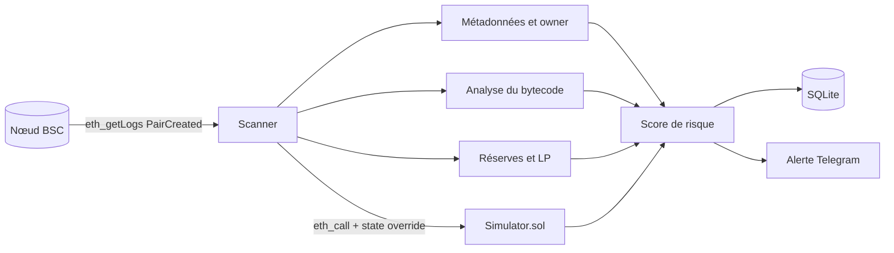

> Évaluation v2 : l'indice numérique est heuristique et non calibré. Il ne représente
> pas une probabilité de sécurité. La couverture de sécurité reste partielle, même
> si achat/transfert/revente réussissent. Les anciens rapports doivent être réanalysés.
> Les alertes `min_score` filtrent un indice, sans recommandation d'achat.
> Les erreurs de simulation et les permissions inconnues ne prouvent pas leur absence.

# RugRadar

**Scanner de risque en temps réel pour les nouveaux tokens listés sur PancakeSwap (BNB Smart Chain).**
Chaque nouvelle paire est analysée en quelques secondes : honeypot, taxes cachées, liquidité, fonctions dangereuses du contrat. Le résultat est un score sur 100, enregistré en base et envoyé sur Telegram.


> Outil d'analyse uniquement : RugRadar ne détient aucune clé privée et n'envoie jamais de transaction.

## Ce qui est vérifié

| Vérification | Comment |
| --- | --- |
| **Honeypot** | Achat → transfert → revente simulés dans un seul `eth_call` (voir ci-dessous) |
| **Taxes** | Écart entre le prix annoncé par le router et ce qui est réellement reçu, à l'achat, à la vente et entre wallets |
| **Liquidité** | Réserve en BNB de la paire et part des tokens LP brûlés (sans conclure au verrouillage externe) |
| **Propriétaire** | `owner()` renoncé, actif ou absent |
| **Fonctions dangereuses** | Analyse du bytecode : `mint`, blacklist, modification des taxes, pause du trading, limites de transaction |
| **Code modifiable** | Présence de `DELEGATECALL` (proxy) ou de `SELFDESTRUCT` |

Les règles de score sont dans [`src/analysis.rs`](src/analysis.rs) : on part de 100 et chaque signal retire des points. Un honeypot vaut toujours 0.

## Simulation sans wallet ni frais

Le cœur du projet est [`contracts/Simulator.sol`](contracts/Simulator.sol). Ce contrat n'est **jamais déployé** : son bytecode est injecté à une adresse vide grâce aux *state overrides* d'`eth_call`, avec un solde fictif de BNB. Dans un seul appel en lecture seule, il :

1. demande au router le nombre de tokens attendus pour l'achat ;
2. achète réellement contre l'état actuel de la chaîne et mesure ce qui arrive ;
3. transfère 1 % vers une autre adresse (détecte les blocages et taxes de transfert) ;
4. revend le reste et compare au prix annoncé.

Si l'achat passe mais que la revente échoue, c'est un honeypot. Rien n'est envoyé on-chain, aucun BNB n'est dépensé.

## Architecture



| Module | Rôle |
| --- | --- |
| `src/scanner.rs` | Boucle de surveillance, reprise au dernier bloc après redémarrage |
| `src/chain.rs` | Appels RPC (alloy) : événements, réserves, simulation |
| `src/bytecode.rs` | Désassemblage EVM et détection des sélecteurs dangereux |
| `src/analysis.rs` | Calcul du score et des constats, entièrement testé |
| `src/store.rs` | Historique SQLite (sqlx, migrations) |
| `src/telegram.rs` | Format et envoi des alertes |
| `contracts/` | Contrat de simulation, tests sur EVM local et test de bout en bout |

## Démarrage

Prérequis : Rust 1.94+ et un endpoint HTTP BNB Smart Chain compatible `eth_getLogs` et *state overrides* (les offres gratuites de la plupart des fournisseurs conviennent).

```bash
cp .env.example .env     # renseignez RPC_URL, et TELEGRAM_* pour les alertes
cargo run --release      # surveille les nouvelles paires
```

Autres commandes :

```bash
cargo run --release -- check 0xADRESSE_DU_TOKEN   # rapport JSON d'un token déjà listé
cargo run --release -- stats                      # tokens analysés et honeypots détectés
```

Avec Docker :

```bash
docker compose up -d --build
```

Exemple d'alerte :

```
Moon Inu (MINU) — score 30/100
🟠 Risque élevé

💧 Liquidité : 0.85 BNB · LP brûlés : 0 %
💸 Taxes : achat 2.0 % · vente 12.0 % · transfert 0.0 %

• taxe à la vente élevée : 12.0 %
• liquidité faible : 0.85 BNB
• LP brûlés : 0 % ; verrouillage externe non vérifié
• propriétaire actif (ownership non renoncé)
```

## Tests

```bash
cargo test                          # score, bytecode, base de données, format des alertes

cd contracts && npm ci
npm test                            # Simulator.sol sur un EVM local avec Uniswap V2
cargo build && npm run test:e2e     # le binaire Rust contre une chaîne locale (id 56)
```

Le test de bout en bout lance un nœud local, y déploie les contrats officiels Uniswap V2 (PancakeSwap V2 en est un fork) et trois tokens : un token normal, un token taxé à 15 % et un honeypot. Il vérifie ensuite que le scanner les découvre et les classe correctement.

Après une modification de `Simulator.sol`, regénérez le bytecode embarqué avec `npm run build` dans `contracts/`.

## Feuille de route

- [ ] Concentration des détenteurs (indexation des `Transfer`)
- [ ] Détection des verrous de liquidité connus (PinkLock, Unicrypt)
- [ ] Paires contre USDT / BUSD et PancakeSwap V3
- [ ] Tableau de bord web de l'historique

## Licence

[MIT](LICENSE) © Adlane Hamzaoui

## Reprise et suivi

Les erreurs d'analyse ou de sauvegarde du curseur interrompent la plage courante :
elle sera retentée au prochain passage. Les tokens enregistrés sont réanalysés
toutes les cinq minutes (100 au maximum par passage), notamment lorsque la paire
n'avait pas encore de liquidité lors de sa création.

Les alertes Telegram passent par une file SQLite persistante. Une alerte initiale
au maximum est mise en file par token ; les échecs sont retentés. La livraison est
au moins une fois : une réponse réseau perdue après réception par Telegram peut
entraîner un doublon. Les réanalyses ne génèrent pas encore d'alertes de changement.

Le champ JSON `assessment.simulation_complete` indique si achat, transfert et vente
ont réussi avec des mesures de taxes disponibles. `assessment.complete` reste
faux : les contrôles n'établissent jamais une couverture de sécurité exhaustive.
Un indice supérieur ou égal à 50 produit désormais un risque `Indeterminate`,
pas un verdict rassurant. Les alertes `min_score` exigent une simulation complète.
Le score numérique reste une estimation partielle non calibrée. Un `owner()` renoncé
ne désactive plus les avertissements sur les fonctions dangereuses : d'autres
rôles peuvent conserver leurs permissions.

`CONFIRMATIONS` (15 par défaut) retarde la découverte pour réduire les effets des
réorganisations courtes. Les réorganisations profondes ne sont pas encore réparées
automatiquement et les lectures d'analyse utilisent toujours l'état récent du RPC.

## Commandes Telegram

Dans le chat privé du bot : `/help`, `/check <adresse>`, `/watch <adresse>`,
`/unwatch <adresse>`, `/watchlist`, `/stats`, `/pause` et `/resume`.
Seul le propriétaire du chat privé configuré peut les utiliser. `/pause` suspend
l'envoi des alertes, sans arrêter le scanner ; `/resume` reprend aussi les messages
en attente. Les commandes restent disponibles pendant la pause. `/watch` ajoute
le token au suivi persistant et au cycle de réanalyse. `/unwatch` retire ce suivi
personnel, sans retirer le token de l'index global du scanner.

## Surveillance, interface locale et exploitation

Le scanner conserve chaque analyse dans `history`. Pour les tokens de `/watchlist`,
il met en file une alerte lorsque la liquidité baisse de plus de 20 % (si elle était
supérieure à 0,1 BNB), le score perd au moins 10 points, un honeypot apparaît, les
taxes achat/vente augmentent ou le propriétaire change. Les événements et leurs
états de livraison sont persistants. Ce suivi périodique peut manquer une modification
survenue puis annulée entre deux passages et la réserve varie aussi lors des swaps.

`/filters` affiche les filtres ; `/filters min_score 75`,
`/filters min_liquidity 1` et `/filters max_tax 1000` les modifient durablement.
Les taxes sont en points de base : 1000 = 10 %. Ces filtres sélectionnent les alertes
initiales ; les alertes de détérioration de la watchlist restent indépendantes.
Les commandes ont une boucle dédiée et un clavier Telegram.

`/deep <adresse>` collecte les emplacements implementation/admin ERC-1967, les
capacités du code d'implémentation, les rôles enumerable admin/minter/pauser et les
rôles observés via `RoleGranted` dont `hasRole` confirme l'activité. La collecte
récente couvre 300 blocs, au maximum 20 détenteurs candidats et 20 rôles. Les
soldes sont relus auprès du contrat ; cet échantillon ne constitue pas un classement
complet des détenteurs, ni une preuve de l'absence de rôles cachés. Les tokens suivis
reçoivent aussi ces données dans leurs rapports. L'enrichissement ne modifie pas
encore le score. Les proxies beacon et les permissions personnalisées ne sont pas
résolus. Les contrats peuvent renvoyer des données trompeuses.

`LP_TIMELOCKS` accepte des adresses séparées par des virgules exposant `token()` et
`releaseTime()` ; le scanner vérifie que le token déclaré est le LP et relève son
solde. C'est une déclaration d'interface, **pas une validation du code du locker**.
Sans adaptateur validé pour un protocole donné, le verrouillage reste inconnu.
Sources des interfaces : https://eips.ethereum.org/EIPS/eip-1967 et
https://docs.openzeppelin.com/contracts/5.x/access-control.

Pour lancer l'interface : `python3 dashboard/server.py`, puis ouvrir
http://127.0.0.1:8787. Recherche, filtre de risque, sélection watchlist, rapport JSON,
historique du score et export CSV sont disponibles. Les routes `/api/tokens`,
`/api/status`, `/api/history?token=...` sont en lecture seule. L'interface écoute
uniquement sur localhost et affiche jusqu'à 2000 tokens et 200 points d'historique.
Ne pas l'exposer directement sur Internet sans authentification.

Sur Linux avec systemd utilisateur, `./scripts/install-service.sh` construit le
binaire puis installe et active le scanner, le dashboard et une sauvegarde quotidienne.
Ces services démarrent avec la session utilisateur ; sans session persistante, ils
ne garantissent pas un démarrage avant connexion. Commandes utiles :

```bash
systemctl --user status rugradar rugradar-dashboard
journalctl --user -u rugradar -f
systemctl --user restart rugradar
systemctl --user stop rugradar rugradar-dashboard
systemctl --user start rugradar-backup.service
```

Les sauvegardes utilisent l'API SQLite online backup, contrôlent l'intégrité et
conservent les 14 fichiers les plus récents dans `backups/`. Pour restaurer : arrêter
le scanner, sauvegarder la base courante, déplacer ses éventuels fichiers WAL/SHM,
copier la sauvegarde vers `rugradar.db`, puis redémarrer. L'historique n'est pas encore
purgé automatiquement ; surveiller l'espace disque. `RPC_FALLBACK_URLS` ajoute des
endpoints de secours : leur chain ID est contrôlé avant le scan. Les échecs de blocs
ou de logs entraînent un basculement. Les autres appels seront retentés au passage
suivant ; l'enrichissement utilise l'URL primaire.

Validation supplémentaire : `python3 -m unittest discover -s dashboard -p 'test_*.py'`.

## Limites de validation

Les tests couvrent le calcul des taxes, les erreurs et booléens ERC-20, les tokens
normaux/taxés/bloqués sur EVM locale, le suivi persistant, le contrôle d'accès
Telegram, le secours RPC et les API du dashboard. Ils ne mesurent pas un taux de
faux négatifs sur un corpus indépendant de scams réels. Ni les détenteurs complets,
ni les permissions personnalisées, ni la sûreté du code des lockers ne sont établis.
La simulation reste un seul appel depuis un contrat avec un montant donné ; elle
ne reproduit pas toutes les adresses, tous les montants et les états futurs.
Une absence de signal signifie seulement qu'aucun des contrôles exécutés n'a relevé
ce signal. Les rapports de version antérieure à 2 sont identifiés comme anciens.

## Simulation multi-scénarios et validation externe

Chaque simulation utilise désormais six scénarios : montant configuré divisé par
10, montant configuré et montant multiplié par 10, avec deux adresses de contrat
et deux appelants. Tous les scénarios sont figés au même bloc ; leurs résultats
et adresses figurent dans `facts.simulation.trials`. Les taxes affichées sont les
maxima observés. Un échec ou une indisponibilité n'est pas masqué par un succès.
Cela ne remplace pas une simulation depuis de vrais EOA ou entre plusieurs blocs.

`/holders <adresse> <bloc_de_déploiement>` vérifie l'absence de code au bloc précédent,
indexe les adresses des événements Transfer depuis la création et relit tous leurs
soldes au même bloc. La somme est rapprochée du supply. Limites : 50 000 blocs,
10 000 adresses, durée de commande 90 secondes, RPC historique requis. Le résultat
est conservé dans SQLite et accessible via `/api/holders?token=<adresse>`. Même un
rapprochement réussi ne prouve pas l'absence de soldes cachés ou d'événements trompeurs.

L'enrichissement `/deep` fixe également ses lectures à un bloc et résout les
beacons ERC-1967. Les rôles custom restent hors couverture exhaustive.
`LP_LOCKER_REVIEWS` permet de charger des références locales JSON avec adresse,
`runtime_keccak256` et source de revue. Le hash du bytecode réellement lu est comparé
à la référence ; cela ne vérifie pas la qualité de la revue et ne valide pas les
lockers arbitraires par défaut. Exemple de méthode, sans adresse fictivement validée.

`scripts/replay.py <manifest.json>` reproduit des observations RPC sourcées à un
bloc fixé. `scripts/benchmark.py` collecte l'état actuel d'un jeu externe de tokens
ayant subi des incidents. Sources et licence sont dans `validation/`. Ce jeu ne
contient pas de témoins bénins et ses étiquettes ne sont pas expertisées ici :
aucune précision de détection ou performance prédictive n'en est déduite.
