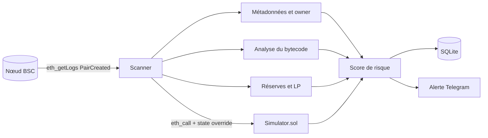

# RugRadar

**Scanner de risque en temps réel pour les nouveaux tokens listés sur PancakeSwap (BNB Smart Chain).**
Chaque nouvelle paire est analysée en quelques secondes : honeypot, taxes cachées, liquidité, fonctions dangereuses du contrat. Le résultat est un score sur 100, enregistré en base et envoyé sur Telegram.


> Outil d'analyse uniquement : RugRadar ne détient aucune clé privée et n'envoie jamais de transaction.

## Ce qui est vérifié

| Vérification | Comment |
| --- | --- |
| **Honeypot** | Achat → transfert → revente simulés dans un seul `eth_call` (voir ci-dessous) |
| **Taxes** | Écart entre le prix annoncé par le router et ce qui est réellement reçu, à l'achat, à la vente et entre wallets |
| **Liquidité** | Réserve en BNB de la paire et part des tokens LP brûlés (liquidité verrouillée ou non) |
| **Propriétaire** | `owner()` renoncé, actif ou absent |
| **Fonctions dangereuses** | Analyse du bytecode : `mint`, blacklist, modification des taxes, pause du trading, limites de transaction |
| **Code modifiable** | Présence de `DELEGATECALL` (proxy) ou de `SELFDESTRUCT` |

Les règles de score sont dans [`src/analysis.rs`](src/analysis.rs) : on part de 100 et chaque signal retire des points. Un honeypot vaut toujours 0.

## Simulation sans wallet ni frais

Le cœur du projet est [`contracts/Simulator.sol`](contracts/Simulator.sol). Ce contrat n'est **jamais déployé** : son bytecode est injecté à une adresse vide grâce aux *state overrides* d'`eth_call`, avec un solde fictif de BNB. Dans un seul appel en lecture seule, il :

1. demande au router le nombre de tokens attendus pour l'achat ;
2. achète réellement contre l'état actuel de la chaîne et mesure ce qui arrive ;
3. transfère 1 % vers une autre adresse (détecte les blocages et taxes de transfert) ;
4. revend le reste et compare au prix annoncé.

Si l'achat passe mais que la revente échoue, c'est un honeypot. Rien n'est envoyé on-chain, aucun BNB n'est dépensé.

## Architecture



| Module | Rôle |
| --- | --- |
| `src/scanner.rs` | Boucle de surveillance, reprise au dernier bloc après redémarrage |
| `src/chain.rs` | Appels RPC (alloy) : événements, réserves, simulation |
| `src/bytecode.rs` | Désassemblage EVM et détection des sélecteurs dangereux |
| `src/analysis.rs` | Calcul du score et des constats, entièrement testé |
| `src/store.rs` | Historique SQLite (sqlx, migrations) |
| `src/telegram.rs` | Format et envoi des alertes |
| `contracts/` | Contrat de simulation, tests sur EVM local et test de bout en bout |

## Démarrage

Prérequis : Rust 1.94+ et un endpoint HTTP BNB Smart Chain compatible `eth_getLogs` et *state overrides* (les offres gratuites de la plupart des fournisseurs conviennent).

```bash
cp .env.example .env     # renseignez RPC_URL, et TELEGRAM_* pour les alertes
cargo run --release      # surveille les nouvelles paires
```

Autres commandes :

```bash
cargo run --release -- check 0xADRESSE_DU_TOKEN   # rapport JSON d'un token déjà listé
cargo run --release -- stats                      # tokens analysés et honeypots détectés
```

Avec Docker :

```bash
docker compose up -d --build
```

Exemple d'alerte :

```
Moon Inu (MINU) — score 30/100
🟠 Risque élevé

💧 Liquidité : 0.85 BNB · LP brûlés : 0 %
💸 Taxes : achat 2.0 % · vente 12.0 % · transfert 0.0 %

• taxe à la vente élevée : 12.0 %
• liquidité faible : 0.85 BNB
• liquidité non verrouillée (0 % des LP brûlés)
• propriétaire actif (ownership non renoncé)
```

## Tests

```bash
cargo test                          # score, bytecode, base de données, format des alertes

cd contracts && npm ci
npm test                            # Simulator.sol sur un EVM local avec Uniswap V2
cargo build && npm run test:e2e     # le binaire Rust contre une chaîne locale (id 56)
```

Le test de bout en bout lance un nœud local, y déploie les contrats officiels Uniswap V2 (PancakeSwap V2 en est un fork) et trois tokens : un token normal, un token taxé à 15 % et un honeypot. Il vérifie ensuite que le scanner les découvre et les classe correctement.

Après une modification de `Simulator.sol`, regénérez le bytecode embarqué avec `npm run build` dans `contracts/`.

## Feuille de route

- [ ] Concentration des détenteurs (indexation des `Transfer`)
- [ ] Détection des verrous de liquidité connus (PinkLock, Unicrypt)
- [ ] Paires contre USDT / BUSD et PancakeSwap V3
- [ ] Tableau de bord web de l'historique

## Licence

[MIT](LICENSE) © Adlane Hamzaoui
